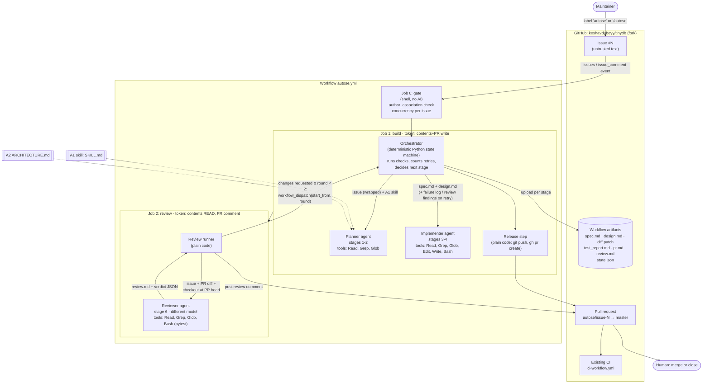

# Component View

How the agents, their tools and the GitHub plumbing fit together.
Status: initial design, written before any agent code (see git history).

## Who can do what

| Component | Kind | Can read | Can write | GitHub token |
| --- | --- | --- | --- | --- |
| Gate | Shell | Event payload | Nothing | read-only |
| Orchestrator | Python (no LLM) | Everything in the job | Artifacts, branch, PR | contents + PR write |
| Planner | LLM agent | Repo (read-only), issue, A1 skill, ARCHITECTURE.md | `spec.md`, `design.md` only (returned as text) | none (never sees it) |
| Implementer | LLM agent | Repo, spec, design | Working tree files | none (never sees it) |
| Release | Python (no LLM) | Branch | Push branch, open PR | contents + PR write |
| Review runner | Python (no LLM) | Issue, PR diff | One PR comment, dispatch next round | contents read, PR write |
| Reviewer | LLM agent | Issue, diff, repo at PR head | `review.md` (returned as text) | none (never sees it) |

Key rule: **no agent ever holds a GitHub token.** Every GitHub write goes through plain code
that the orchestrator controls (ADR-005, to be written).
