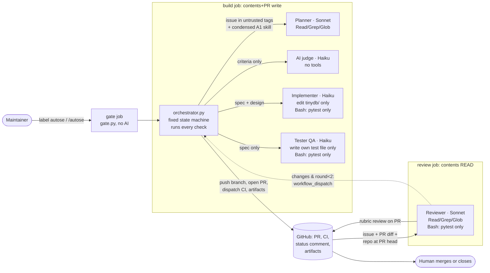
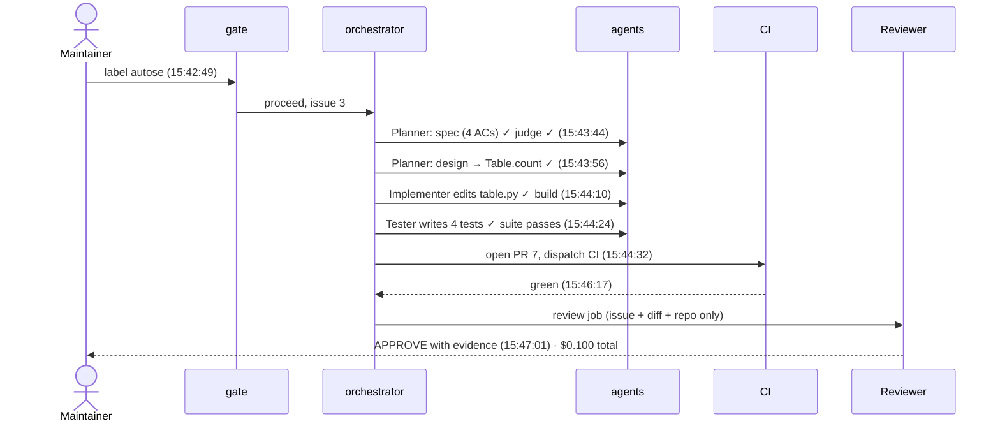

**Repository:** github.com/keshavdubeyy/autose-a3 · **Fork:** github.com/keshavdubeyy/tinydb, pinned at upstream `edff96a` · **Models:** Claude Sonnet 5.5 (Planner, Reviewer) and Claude Haiku 5.5 (Implementer, Tester, judge) · **Total spend:** $1.10 over 23 workflow runs.

**Headline results.**

- All 5 issues ended with a reviewer-approved PR, and 16/16 hidden tests pass on the bot's branches. One issue (#5, the vague one) needed a single maintainer clarification after the pipeline correctly stopped and escalated.
- The reviewer gave the right verdict on 5/5 seeded PRs.
- Neither decision experiment changed a verdict. Both are negative results, and we report them as such.

# 1. Architecture

The workflow (`.github/workflows/autose.yml`) has three jobs. Each job has its own token permissions:

- **gate** (`issues: write`, `actions: write`, read-only contents) decides whether a run may start. It uses no AI.
- **build** (`contents: write`, `pull-requests: write`) runs stages 1–5. A deterministic Python state machine, `orchestrator.py`, calls three agents through the Claude Agent SDK and runs a check after every stage.
- **review** (`contents: read`) runs stage 6. The independent Reviewer runs here and cannot push.

**No agent ever holds the GitHub token.** The orchestrator removes it from the environment before any agent starts. All GitHub writes (push, PR, comments) are plain code.

**Component view.** The figure shows which agent knows what (arrows are hand-offs).

**Stage map.** Each stage has one agent, one artifact and a check that the orchestrator decides with code.

| # | Stage | Agent | Artifact | Check (decided by code) | On failure |
|---|---|---|---|---|---|
| 1 | Requirements | Planner (Sonnet) + judge (Haiku) | `spec.md` | Goal present; 1–8 ACs in Given/When/Then; judge rates each AC testable | retry once with the reason, then stop + escalate |
| 2 | Design | Planner (Sonnet) | `design.md` | every named file/function exists, or is marked NEW; no tests/CI/pipeline files | retry once, then stop |
| 3 | Implement | Implementer (Haiku) | `diff.patch` | only `tinydb/` changed (other edits reverted); package compiles and imports | back to 3 (max 3 attempts), then design redo (once), then stop |
| 4 | Test | Tester (Haiku) | `test_report.md` | one `test_ac_<n>` per AC; full suite passes | tests stay fixed; back to 3 |
| 5 | Release | plain code | `pr.md` + PR | PR open; CI green | back to 3 with the CI log |
| 6 | Review | Reviewer (Sonnet) | `review.md` | rubric R1–R6 valid, with evidence; APPROVE only with no failed row | code → 3, approach → 2; max 2 rounds; then a human |

**Sequence view: a real run** (issue #3, run 44920637328, UTC times from the status comment). The full diagram is in `architecture/views/sequence-view.md`.

# 2. Design decisions

Thirteen ADRs (Nygard format) are in `architecture/decisions/`. ADR-001 is kept and marked *Superseded* by ADR-011.

| ADR | Decision | Chosen option | Main option rejected | Main reason | Status |
|---|---|---|---|---|---|
| 001 | D1 splitting the work | 3 agents; Implementer writes its own tests | 1 agent | fewer hand-offs | Superseded by 011 |
| 011 | D1 splitting the work | 4 agents: Planner, Implementer, Tester, Reviewer | Implementer tests itself | a builder only tests what it expects to work | Accepted |
| 002 | D2 control flow | fixed state machine + escalation report | an LLM manager picks the next step | shows exactly where it failed; cannot be argued out of the rules | Accepted |
| 003 | D3 hand-offs | each agent gets only what it needs; Goal section in spec | pass everything forward | extra context misleads and carries injected text | Accepted |
| 004 | D4 state | artifacts + status comment; resume after re-checking | restart / resume blindly | keep good work, don't trust half-done work | Accepted |
| 005 | D5 tools | per-agent allowlists + PreToolUse guard; no agent touches GitHub | GitHub MCP for agents | no agent's job needs a write token | Accepted |
| 006 | D6 models | Sonnet for Planner + Reviewer, Haiku for the rest | Opus everywhere | small budget; cheap builder checked by a stronger model | Accepted (evidence added) |
| 007 | D7 checks | code checks first; AI judge only for "testable?" and the review | AI judge at every gate | exact questions get exact, free answers | Accepted |
| 008 | D8 reviewer independence | own job, read-only, different model, sees no spec, evidence rubric | reviewer sees the implementer's reasoning | reasoning anchors the reviewer | Accepted (evidence added) |
| 009 | D9 safety & failures | $1/issue, 15 min agent time, untrusted-input layers | rely on the provider cap | one bad run must not drain the month | Accepted |
| 010 | D10 triggers | anyone can request; collaborators approve; one run per issue + queue notice | anyone's comment starts a run | strangers could drain the budget | Accepted |
| 012 | D3/D10 clarifications | maintainer comments become "Clarifications"; others ignored | read all comments | strangers' comments are the easiest injection path | Accepted |
| 013 | D5/D9 command guard | only `python -m pytest`; accept wasted turns | allow `| tail` / `| head` | a wasted turn is ~free; each allowed command is a new leak path | Accepted |

**The three decisions that mattered most.**

*ADR-011: a separate Tester (QA) agent.* My first design (ADR-001) let the Implementer write its own tests. While reviewing it, I did not accept that a builder should check its own work. It will test the cases it already believes work. The cases that would break the code are exactly the ones it didn't think of. So the Tester sees only the spec, never the design or the Implementer's conversation, and the Implementer cannot edit the tests: the orchestrator reverts any change outside `tinydb/`.

In the real runs, the Tester's suites passed on the first try, so the "tests stay fixed" rule was exercised in two places. On issue #5, CI failed and the Implementer fixed the code while the tests stayed untouched. In the offline tests of the state machine, the failing-tests path sends work back three times without ever rewriting the tests. On issue #2, the reviewer's send-back kept the same tests, and the new round still had to pass them. The cost of the extra agent is about $0.003 per issue.

*ADR-002: a fixed checklist instead of an AI manager.* I wanted every run to show where it failed and why. A Python state machine makes each transition a rule that can be read and tested: three implementation attempts, then one design redo, then stop. No model can be talked out of these rules, including by text in an issue.

When the vague issue (#5) could not produce testable criteria, the pipeline stopped at stage 1 and posted a report. The report covered what went wrong, why, where, what was tried, the options and their trade-offs. It did not guess, and so it produced no wrong code. The trade-off is rigidity. A smarter manager might have rephrased the criterion itself, but it could equally have hidden the problem.

*ADR-008: an independent reviewer that must show evidence.* The reviewer runs in its own job with a read-only token and a different model. It sees only the issue, the diff and the repository at the PR head. It must fill a six-row rubric with evidence, such as file:line references or test output. Code rejects a review where APPROVE has a failed row, or where "changes requested" has no failed row or no finding with a file and line. Without this, a reviewer can simply approve everything.

On the pipeline's own PRs, the reviewer sent issue #2 back once. The fix had made `update()` atomic, but the reviewer pointed out that `update_multiple()` had the same partial-update bug. Nobody had reported that, and the hidden tests didn't cover it. The next round fixed it.

# 3. Decision experiments

Both experiments reuse the five seeded PRs (§4), whose correct verdicts are known. Only one variable changes in each (`experiment/variants.md`). All runs are linked in `results/experiments.md`.

| Seeded PR (label) | Default: Sonnet | **A**: Haiku reviewer | **B**: Sonnet + spec |
|---|---|---|---|
| S1 clean → APPROVE | ✅ APPROVE | ✅ APPROVE | ✅ APPROVE |
| S2 cache bug → CHANGES | ✅ R1, R4 | ✅ R4, R5 | ✅ R1, R4 |
| S3 weak tests → CHANGES | ✅ R3 | ✅ R3, R4 | ✅ R3 |
| S4 risky fsync removal → CHANGES | ✅ R5 | ✅ R5 | ✅ R5 (spec listed it as FR-3) |
| S5 clean → APPROVE | ✅ APPROVE | ✅ APPROVE | ✅ APPROVE |
| Correct / cost of 5 reviews | 5/5 · $0.133 | 5/5 · **$0.019** | 5/5 · $0.148 |

**Experiment A (ADR-006): does the reviewer need the stronger model?** We expected Haiku, the same model as the Implementer, to miss defects or approve more. It did not. It got all five verdicts right at about one seventh of the cost.

Its rubric was less precise: it filed S2's logic bug under R5, "risky change". It also went deeper once: on S3 it noticed that an old table handle can cache stale results after a table is re-created.

**What I changed:** I kept Sonnet. A review costs about $0.03 per issue, the reviewer is the last check before a human, and the case where Sonnet shone (a second, unreported copy of a bug in issue #2) was not tested with Haiku. I added this evidence to ADR-006 and wrote down that the argument for the decision is now weaker. If a harder seeded set also shows no gap, ADR-006 should be superseded.

**Experiment B (ADR-008): does seeing the spec make the reviewer agree with the implementer?** We wrote specs from the implementer's point of view, so for S2–S4 each spec agrees with the planted defect. The strongest case is S4, whose spec lists "remove fsync for speed" as a requirement. The reviewer still failed R5 and noted that the issue never asked for it. It judged the spec against the issue, not the other way round. No verdict changed.

**What I changed:** the rule stays, since hiding the spec costs nothing, but ADR-008 now calls it a precaution, not a measured effect.

**A validity lesson.** In one B trial, the reviewer tried `cat … spec.md`. Our command guard denied it (ADR-013), and the reviewer never fell back to the Read tool, so it never saw the spec. We found this only by checking the log. We marked the trial invalid and re-ran it, and the re-run read the spec and gave the same verdict. Every experiment needs a check that the treatment actually happened.

# 4. Results

**Issue runs.** There were 7 build runs over 5 issues: one first pass per issue, one review round for #2, and one re-run of #5 after a clarification.

| Stage | Passed first try | Passed after a retry | Notes |
|---|---|---|---|
| 1 Requirements | 3/6 | 5/6 | #1: the judge rejected a vague AC ("consistent with storage"). #5b: one AC was not in GWT form. #5a: rejected twice → escalated |
| 2 Design | 5/5 | 5/5 | every named target existed |
| 3 Implement | 5/5 | 5/5 | no edit outside `tinydb/` had to be reverted; 1 extra attempt came from CI (#5b) |
| 4 Test | 5/5 | 5/5 | 23 ACs, each with at least one test; full suite green each time |
| 5 Release (CI) | 4/5 | 5/5 | #5b failed the mypy type check on CI → Implementer fixed it |
| 6 Review | 4/5 approve | 5/5 approve | #2 sent back once (real defect, see §2) |

**Hidden tests:**

- **First pass, no human input:** 4/5 issues reached an approved PR, and all 4 passed their hidden tests (13/13).
- **After one maintainer clarification on #5:** 5/5 issues have an approved PR, and hidden tests pass 16/16.
- **Cost:** $0.77 for all pipeline runs, mean $0.15 per issue, maximum $0.21 (#5, both runs). The median build run took 4.3 minutes, about 2 of them waiting for CI.

**What the reviewer caught, and where it was wrong.**

- **Seeded PRs:** 5/5 correct verdicts, and the expected rubric row failed every time. It named the exact line and cause of S2's cache bug ("truncated before the cache store") and suggested the right fix. It said S3's tests "pass without the fix", and it rated S4's fsync removal high severity.
- **Pipeline PRs:** one send-back (#2), and it was correct.
- **Wrong:** across the 10 PRs and 21 reviews, we saw no false approval and no rejection of a correct change.
- **Imprecise:** the Haiku variant once put a defect in the wrong rubric row, and a few APPROVE reviews carried low-severity nits (for example, docstrings not updated).
- **Not measured:** how often it would miss a subtle defect. Our seeded defects were each single and visible.

**Tokens.** The pipeline runs used 1,139,503 input tokens (most of them cache reads) and 66,395 output tokens. The 16 review-only runs cost $0.34 more. Their token counts were not logged per run (see §6). The provider console reports TOTAL_TOKENS_PLACEHOLDER tokens in total for the project key.

# 5. Hindsight

If I started again tomorrow, the first decision I would change is **what counts as the issue** (ADR-003, later ADR-012). I designed the agents to read only the issue's title and body. That seemed like the cleanest, least-injectable input, and I never asked how a maintainer would clarify a vague request. On a real project, that happens in the comments.

The vague issue showed the gap. The pipeline did the right thing and stopped. But when I wrote the clarification, the agents could not see it, and the fix needed an extra pipeline PR and a second run. If comments from maintainers had been part of the input from the first day, with strangers' comments excluded for the same security reason, #5 would have been a normal two-step conversation. The security rule did not need to change, only where I applied it.

# 6. Limitations and threats to validity

1. **Small samples.** There are 5 issues and 5 seeded PRs, with one run per variant. LLM output varies between runs: a single flip changes 5/5 into 4/5, and no difference in Experiments A and B can be called significant.
2. **The same author wrote the tests and the defects.** I wrote the issues, the hidden tests, the seeded defects and the reviewer rubric. The seeded defects map neatly onto rubric rows (R1/R3/R5), and each PR has a single defect. A harder or independently written set could show misses that we did not see.
3. **The hidden tests encode one reading of each issue.** For the vague issue in particular, they encode "missing field counts as 0", and a maintainer clarification was given before the second run. That clarification was written by me, knowing the intended behaviour.
4. **One small, well-tested codebase.** TinyDB is about 2,300 lines of library code, with a fast suite and a clear architecture document from A2. Results may not carry over to larger or messier repositories.
5. **Logging gaps.** Review-only runs logged cost but not tokens, and only the last attempt of each agent call keeps a full transcript. Costs are as reported by the SDK.
6. **The model versions are fixed in time.** The results hold for Claude Sonnet 5.5 and Haiku 5.5 as of 21 Nov 2026.

# Appendix: where to find everything

- **Runs, PRs, reviews:** `results/runs.md` and `results/experiments.md`. Per-run data: `results/results.csv` (23 rows).
- **Views:** `architecture/views/` (component view, sequence view, stage map). ADRs: `architecture/decisions/` (001–013).
- **Code:** `workflow/` (an exact copy of the fork's `autose.yml` and `.autose/`, with 19 offline tests).
- **Inputs:** `experiment/issues`, `experiment/hidden_tests`, `experiment/seeded_prs` (diffs + labels), `experiment/variants.md`.
